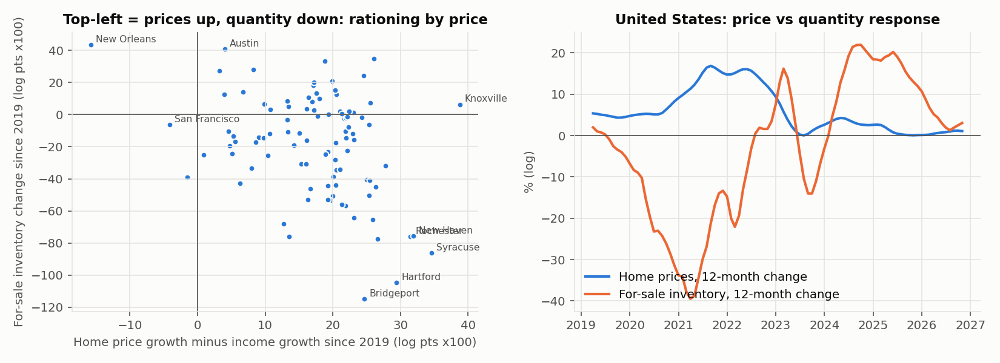

# The Housing Shortage Tax

*How a shortage of about four million homes turns into income taken from renters and new buyers, and leaves the households with the least on the losing side of the housing match.*

Working paper, November 2026. Data: Zillow Research, FRED and US Census (household, vacancy, permit and population series), 1965 to October 2026. Every number below is produced by the code in this repository (`python run_all.py`). The full technical framework, with propositions and proofs, is in [paper/framework.md](paper/framework.md). **[Read the formatted whitepaper](https://wesboyt.github.io/elastic-matching/whitepaper/)**.

| | |
|---|---|
| **3.8M** | homes short in 2025 (range 0–4.9M), almost all as households that never formed |
| **+6.5% prices, +2.4% rents** | at a shortage of this size, estimated from 241 metros |
| **~$100B a year** | more paid by renters than if rents had tracked incomes since 2000 |
| **$6–8T** | of home value above what incomes or building costs justify |
| **3.0 → 4.0** | typical home price as a multiple of median income, 2000 to 2026 |

## 0. Summary

We model housing as a **matching market**. Households on one side, homes on the other. Matching theory tells us exactly what happens when one side is short. The short side captures the gains from trade. The long side pays for it in money and in worse matches, or ends up with no match at all.

In the United States today, households are the long side.

Our thesis is that this is a **congestion problem that rewards holding over producing**. Most of the dollars involved are not lost to the economy outright. They are **moved**: from people who rent or are buying now, to people who already own and to the lenders who finance the gap. That money is no longer available for anything else these households would have spent or invested it on. Section 6 separates the parts of this claim our evidence establishes from the parts it does not yet establish.

## 1. The model: housing as a matching market

Each household occupies one home; each home houses one household. That is a two-sided assignment problem, the same mathematics used to match medical residents to hospitals and students to schools (Gale & Shapley 1962; Shapley & Shubik 1971). We use two versions:

- **With money** (the assignment game). Prices clear the market. The set of competitive prices is an interval with a household-friendly end and an owner-friendly end. Which end the market lands on depends on which side is short.
- **Without money** (Gale–Shapley). This shows what scarcity does to the *quality* of matches, measured as **regret**: how far down your own list your match is. Zero regret means you got your first choice.

The key result: once demanders outnumber homes, competition among the demanders hands nearly all of the surplus to owners. In our simulation, the owners' share of the gains goes from **1–2%** when homes are plentiful to **99–100%** when demanders outnumber homes by a quarter. Any price inside the competitive range stays inside it. Nobody has to collude for this to happen.

*The shaded band is every price consistent with competition. Past one demander per unit, even the most tenant-friendly competitive price gives owners most of the gains.*

## 2. How many homes short?

We count **homes on the market** (occupied, plus vacant for rent, plus vacant for sale) and compare them with **would-be households**. Would-be households are the number of households that would exist if adults formed them at 1990 rates, adjusted for an older population. We allow 3.3% vacancy for normal moving (the 1965–1999 average).

The age adjustment matters. Households per adult has stayed flat at about 0.49 since 1990. Over the same period the population aged sharply, and people over 65 head their own households far more often than younger adults. On its own, aging should have pushed household formation up. It did not. That is what a shortage looks like, although changing social norms (later marriage, more shared living) could explain part of it.

*The US went from a surplus of about 3.5M homes in the 2005 bubble to a shortage of about 3.8M today. Today's gap shows up as households that never formed (young adults at home, doubled-up families), not as low vacancy. Jumps near 1980 and 2001 are Census re-benchmarking breaks in the household series.*

| Year | Homes per would-be household | Net shortage (M homes) | Reading |
|---|---:|---:|---|
| 1970 | 0.937 | +4.4 | Baby boomers forming households; partly different household norms |
| 1990 | 1.005 | −0.5 | Balanced (base year) |
| 2005 | 1.030 | −3.5 | Bubble overbuilding |
| 2015 | 1.004 | −0.5 | Back to balance |
| 2025 | 0.973 | +3.8 | Short; range 0–4.9M across assumptions |

## 3. How shortages take income

We ran a matching market for every year from 1965 to 2025. Each year uses that year's ratio of homes to would-be households and that year's real incomes. We then compared it with a **balanced** market at the same incomes. The difference is the effect of the shortage and nothing else.

*In the model, the shortage alone raises 2025 rents by about 12.6%, roughly $96B a year from renters (about $276B if owners' implied rent is counted). It also leaves an extra 1.7% of would-be households without a home of their own. The metro data below give a smaller effect.*

### Testing it in the data: 241 metros, 2011–2025

For every metro we counted the homes its new residents needed (at 2.5 people per home, plus replacement of worn-out homes) and subtracted the homes actually permitted. The difference, added up since 2010, is that metro's shortage. We compared metros with each other, removing anything that moved all metros together, such as national incomes, interest rates and inflation.

- **Shortages go with faster price and rent growth.** Each 10 homes per 1,000 residents of shortage means about **+5.9% home prices** (95% CI 4.7–7.1%, 241 metros) and **+2.2% rents** (CI 1.1–3.4%, 151 metros).
- **Building more slows growth.** For metros with the same population growth, 10 more homes permitted per 1,000 residents over 2015–24 means **2.0% slower rent growth** and **3.7% slower price growth** to 2025.
- **The direction of the bias favours the finding.** Developers build where they expect rents to rise, which makes building look less effective than it is. So the true effect of building is, if anything, larger.
- **Robustness.** Metros whose boundaries were redrawn between Census files had to be dropped, because their population counts jump artificially. The results hold whether the cutoff for "redrawn" is a 1%, 2%, 3%, 5% or 10% population jump. They disappear only when the redrawn metros are kept in.

*Same population growth, more building: slower rent growth. Applied to a shortage of national size (about 11 homes per 1,000 residents), these estimates mean about +2.4% rents and +6.5% prices. That is about a fifth of the model's rent effect. Part of the gap is expected, because people can move away from a local shortage but not from a national one.*

Two more results:

- **A shortage becomes a price only when the people left out can afford to outbid.** The 1970s were more short than today, but at 1970s incomes most excluded households could not have paid construction cost anyway. Today they can, so they bid against each other, and owners collect the difference.
- **How much renters pay above income growth.** Comparing actual rents with rents that had grown in line with median income since 2000 gives an excess of about **$100B a year** (about $226B against inflation), or about **$1.5T** in total since 2000. This measures the total gap. It does not say how much of the gap the shortage caused.

*Home values have pulled away from both incomes and building costs. The typical home is about $70–93k above those paths, which adds up to $6–8T across owner-occupied homes. The carrying cost of that excess, about $0.4–0.5T a year, falls on recent buyers. The base year matters: measured from 2012, the excess rent paid by sitting tenants disappears. Since then the squeeze has landed on movers and new buyers.*

Why prices outran incomes: about 40% of the gap is rents rising faster than incomes. About 60% is a higher price-to-rent ratio, meaning low interest rates turned expected scarcity into higher asset prices. In the model, falling interest rates inflate prices *only* where supply is constrained. Where homes can be built freely, prices stay at building cost whatever rates do.

## 4. How shortages increase regret

Without money, scarcity shows up as worse matches. Our simulations reproduce two published results, and add one that matters for housing.

*Distance from zero regret. Left: in a balanced market the passive side's regret grows like n/ln n and the active side's like ln n. The passive side is exponentially further from zero regret (Pittel 1989). At 200 per side: 4.7 vs 33.8. Right: in unbalanced markets the short side's regret is about ln(1/surplus), whoever proposes (Ashlagi, Kanoria & Leshno 2017).*

1. **The side that is short wins, and the long side's regret explodes.** With one extra person on the long side, its average regret jumps from about 5 to about 35 (out of 200). Whether that side proposes or receives barely matters once the market is unbalanced.
2. **In housing the burden lands on the bottom (model result).** We model housing preferences as largely shared: most people want the same better homes, and owners prefer higher-income tenants. Under shared preferences the cliff disappears. A shortage then mainly decides *who is left with nothing*, and those are the lowest-ranked households. The shortage does not make everyone's home slightly worse. It shuts the bottom of the market out, through price and through exclusion.

*When everyone agrees which homes are best, imbalance decides how many people at the bottom are left out rather than shifting everyone's match.*

## 5. Exploitation: when owners profit from emptiness

Scarcity creates a second incentive. A large owner can raise every other rent it collects by holding units empty. Under competitive prices in our model:

- a landlord with 10% of a market keeps **4 units empty** and rents rise **8.7%**;
- with 25% it keeps **14 empty** (+39%);
- with 50%, **22 empty** (+52%);
- with no concentration, none.

Withholding only pays when new supply cannot respond. If a withheld unit can be replaced by a new one, the strategy fails.

These are model results; we have not measured withholding in real ownership data.

The same matching mathematics applies outside housing, again as model results with illustrative parameters. In a model market with four meat processors, farm-gate prices settle about **20%** below value, exactly as monopsony theory predicts. In a model where patients can see only one price, a $5,000 procedure sells for about **$36,000** however many providers exist. Price transparency only helps there when there is spare capacity.

## 6. What the evidence supports, and what it does not yet

A whitepaper that argues for change has to be clear about the strength of each claim. This is our own assessment:

| Claim | Status | Evidence |
|---|---|---|
| The US is short about 4 million homes relative to would-be households | **Supported** | 3.8M central estimate; 0–4.9M across assumptions; consistent with published estimates |
| Metros with bigger shortages see faster rent and price growth | **Supported** | Metro panel: +2.2% rents, +5.9% prices per 10 homes per 1,000 residents short; robust to the boundary filter |
| Building more homes slows rent and price growth | **Supported** | Same population growth, 10 more homes per 1,000 residents: rents −2.0%, prices −3.7%. Bias runs against the finding |
| Size of the shortage's effect on rents | **Range** | About +2.4% (metro data, a within-country lower bound) to +12.6% (calibrated model) |
| Renters pay about $100B a year more than income growth would imply | **Supported** | Measured gap since 2000; size depends on base year; not all of it is caused by the shortage |
| Most of the money is a transfer, not destroyed output | **Supported** | Directly destroyed output is $2–8B a year. Wider growth losses (workers unable to move to productive cities) are argued in the literature but disputed, and we did not measure them |
| Shortage harms concentrate on the lowest-ranked households | **Model only** | Follows from shared-preference matching; not measured in household data |
| Low interest rates inflate prices mainly where supply is constrained | **Mixed** | Confirmed with a land-share proxy; not with the pre-specified index; not before 2020 |

> **What the evidence establishes.** The country is short of homes. Where the shortage is bigger, rents and prices rise faster. Where more is built, they rise more slowly. The extra money flows from renters and new buyers to existing owners. We do not test what caused the shortage. Prior research links land-use rules to high prices in constrained metros (Glaeser & Gyourko 2018), but our data cannot separate rules from other barriers.

## 7. What would fix it, and how to know if it is getting worse

In the model, the remedy is to make supply responsive again. Responsive supply removes the scarcity rent, the incentive to withhold, and the link between interest rates and asset prices, all at once. The metro data support the central step: more building, slower rent growth.

- **Let quantity respond to price.** Wherever homes sell far above the cost of building them, find and remove what stops new supply. Which barriers matter most in each metro is beyond what this paper tests.
- **Make withholding unprofitable.** The model says to watch vacancy where ownership is concentrated.
- **Watch for regression.** Our monitor flags metros where prices outran incomes while for-sale inventory fell. Syracuse, Hartford, Rochester, New Haven and Bridgeport lead today; Austin and San Antonio, where building boomed, do the opposite.

*Points in the lower right are metros where prices rose faster than incomes while the stock offered for sale shrank.*

Decisive next tests, in order:

1. An **instrumented version of the metro test**, using supply shifters that developers do not choose, such as geography or regulation changes. It would turn the association into a causal estimate.
2. A rate-sensitivity test using an exogenous supply measure (the Saiz or Wharton regulation indices) and monetary-policy surprises.
3. Natural experiments in reform (Auckland 2016, Minneapolis 2040) to measure what happens to quantity and rents when supply is freed.

**References.** Ashlagi, Kanoria & Leshno (2017) *JPE*. Demange, Gale & Sotomayor (1986) *JPE*. Gale & Shapley (1962) *AMM*. Glaeser & Gyourko (2018) *JEP*. Greaney (2020) working paper. Hsieh & Moretti (2019) *AEJ: Macro*. Leonard (1983) *JPE*. Pittel (1989) *SIAM J. Discrete Math.* Saiz (2010) *QJE*. Shapley & Shubik (1971) *IJGT*.

*Simulations are stylised and their parameters illustrative; empirical estimates rest on the assumptions stated in each section.*

---

# Code and reproduction

This project models housing, food/agriculture and healthcare as **two-sided
matching markets**. It measures scarcity rent, market power and lost trade,
and estimates how much US housing scarcity transfers from non-owners each
year.

* **Technical framework:** [paper/framework.md](paper/framework.md). It has the
  model, measures, proofs, results, the experiments that detect regression, and
  the limitations.
* **Reproduce:** `python run_all.py` (about 15 minutes; downloads about 9 MB of
  public Zillow, FRED and Census CSVs into `data/raw/`).

| Path | What it does |
|---|---|
| `mel/assignment.py` | Assignment game solver plus exact core bounds (buyer-optimal/VCG and owner-optimal prices) |
| `mel/gale_shapley.py` | Deferred acceptance (matching without money) |
| `mel/metrics.py` | Scarcity rent, owner share, core position, Lerner, DWL, elasticity, HHI |
| `sims/s01_dating.py` | Toy dating market: short-side power, with and without money |
| `sims/s02_housing.py` | Housing supply regimes, capitalisation under falling rates, landlord withholding |
| `sims/s03_food.py` | Farmers matched to few processors (monopsony); checked against theory |
| `sims/s04_healthcare.py` | Patients ↔ providers with insurance, capacity caps, price opacity |
| `data_pipeline/fetch_data.py` | Downloads Zillow ZHVI/ZORI/inventory, FRED series and Census permit/population files |
| `data_pipeline/housing_extraction.py` | US excess rent / excess home value vs income-, inflation- and cost-anchored counterfactuals |
| `data_pipeline/monitor.py` | Metro "market regression" screen (prices vs incomes vs quantity) |
| `data_pipeline/e2_rate_gradient.py` | Experiment E2: do constrained metros react more to interest rates? (local projections, two-way clustered) |
| `sims/s05_e2_method_check.py` | Runs the E2 estimator on synthetic data where the answer is known (true effect / placebo / confound) |
| `sims/s06_imbalance_shape.py` | How each side fares as a Gale-Shapley market becomes unbalanced (random vs shared preferences, regret scaling) |
| `data_pipeline/shortage.py` | US homes vs would-be households, 1965-today: age-adjusted shortage accounts |
| `sims/s07_housing_history.py` | A matching market for every year calibrated to that ratio; the shortage's own effect on rents; tests against actual rents/prices |
| `data_pipeline/metro_shortage.py` | Metro panel: homes permitted vs homes new residents needed, against Zillow rents and prices (fixed effects, robustness to boundary changes) |
| `whitepaper/` | Styled HTML version of the paper above, with its figures |
| `outputs/` | Figures (PNG) and tables (CSV) |

Requires Python 3.10+ with numpy, scipy, pandas, matplotlib and requests.
