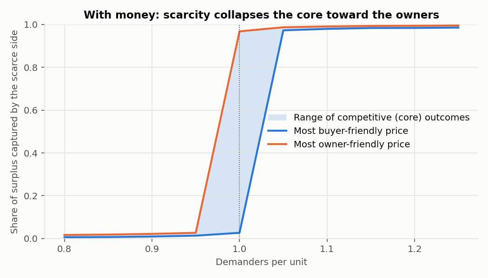
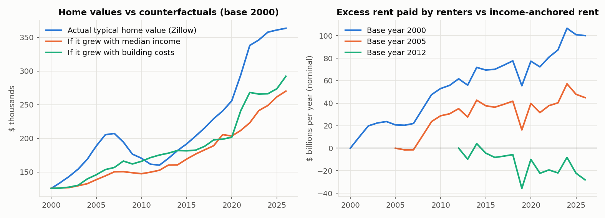
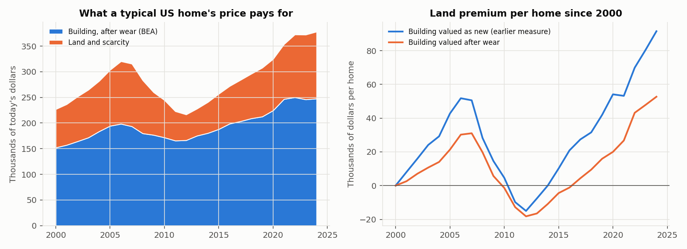
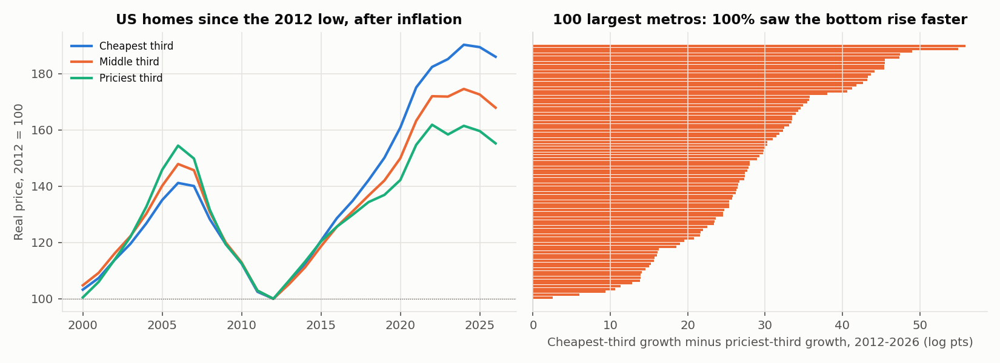
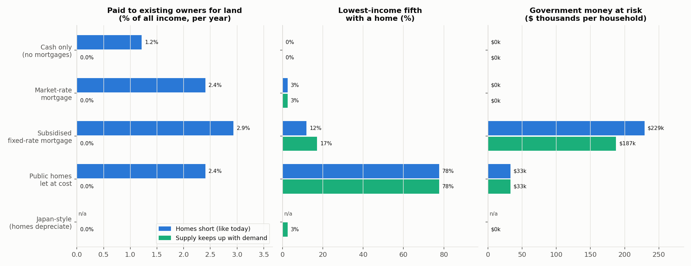
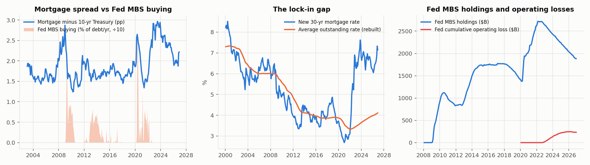

*Working paper · Matching Elasticity Lab · November 2026*

# The Housing Shortage Tax

*The United States is about four million homes short. In a market where households are matched to homes, that shortage hands the gains to people who already own, takes income from people who rent or are buying now, and passes the bill to the next generation. The poorest households are pushed out first.* **[Read the formatted whitepaper](https://wesboyt.github.io/elastic-matching/whitepaper/)**.

Data: Zillow Research, FRED, US Census, Bureau of Economic Analysis and Federal Reserve, 1965 to October 2026. Every number below comes from open code (`python run_all.py`). The technical framework, with proofs, is in [paper/framework.md](https://github.com/wesboyt/elastic-matching/blob/main/paper/framework.md).

| | |
|---|---|
| **3.8M** | homes short in 2025 (range 0–4.9M), almost all as households that never formed |
| **+6.5%** | higher home prices (and +2.4% rents) at a shortage of this size, from 241 metros |
| **~$100B** | a year more paid by renters than if rents had tracked incomes since 2000 |
| **$5–8T** | of home value that is a claim on future families' income |
| **1.4× → 2.2×** | price of the cheapest homes relative to median income, 2000 to 2026 |

## The argument in brief

1. **We are short of homes.** Counting the households that would exist at normal rates of household formation, the country is about 3.8 million homes short, up from rough balance in 2015.
2. **A shortage hands the gains to owners.** Housing is a matching market: households on one side, homes on the other. Matching theory says the short side captures the gains. When homes are short, owners collect them, and households pay in money, in worse matches, and, at the bottom, by being shut out.
3. **It costs real money today.** Metros that built less per new resident saw faster rent and price growth; metros that built more saw slower growth. Renters pay about $100 billion a year more than if rents had tracked incomes.
4. **The bill goes to future families.** The land part of a home's price is the present value of the rents future occupants will pay. When it rises, today's owners gain exactly what future families will pay, and nothing new is produced to pay it with.
5. **The bottom rung goes first.** The cheapest homes have risen fastest in every large metro. Flippers and landlords can outbid first-time buyers precisely because homes are short.
6. **Finance feeds it.** With homes short, mortgage credit and its subsidies flow into land prices instead of more homes. Fixed-rate mortgages shift interest-rate risk to lenders, a large share of them public.
7. **The fix is supply that keeps up.** When new homes get built whenever prices rise above cost, the land premium disappears under every way of paying for housing. Public homes let at cost reach the households the market leaves out.

Section 8 rates every claim by the strength of its evidence, including the ones that did not hold up.

## 1. We are short of homes

We compare **homes on the market** (occupied, plus vacant for rent or for sale) with **would-be households**: the households that would exist if adults formed them at 1990 rates, adjusted for an older population. We allow 3.3% vacancy so people can move (the 1965–1999 average).

The age adjustment matters. Households per adult have stayed flat at about 0.49 since 1990, while the population aged sharply, and people over 65 head their own households far more often than younger adults. Aging alone should have pushed household formation up. It did not, which is what a shortage looks like, though changing social norms (later marriage, more shared living) could explain part of it.

*From surplus to shortage. About 3.5M homes in surplus at the 2005 peak of overbuilding; about 3.8M short today (range 0–4.9M across assumptions). Today's gap is households that never formed, such as young adults at home and doubled-up families, not low vacancy. Jumps near 1980 and 2001 are Census re-benchmarking breaks.*

## 2. Why a shortage hands the gains to owners

Each household occupies one home and each home houses one household: a two-sided matching problem, the same mathematics used to match medical residents to hospitals (Gale & Shapley 1962; Shapley & Shubik 1971). Its central result is that **the short side captures the gains**, and no one has to collude for that to happen.

- **With prices.** Once households outnumber homes, competition among households hands nearly all the gains from trade to owners. In our simulation the owners' share goes from **1–2%** when homes are plentiful to **99–100%** when households outnumber homes by a quarter.
- **Without prices, in worse matches.** Measured by how far down your own list your match is ("regret"), the long side does far worse. With one extra person on the long side of a 200-person market, its average regret jumps from about 5 to about 35, whoever makes the offers (Ashlagi, Kanoria & Leshno 2017).
- **In housing, the bottom is shut out.** Housing preferences are largely shared: most people want the same better homes, and owners prefer higher-income tenants. Under shared preferences, a shortage does not make everyone's match slightly worse. It decides **who is left with nothing**, and those are the lowest-ranked households (a model result).
- **Owners can even profit from emptiness.** In the model, a landlord with 10% of a market earns more by keeping 4 units empty, raising rents 8.7%. That only works when new supply cannot respond.

*Scarcity hands the market to owners. The shaded band is every price consistent with competition. Past one household per home, even the most tenant-friendly competitive price gives owners most of the gains.*

## 3. What it costs today

**Across metros, building less means paying more.** For 241 metros, we counted the homes each metro's new residents needed and subtracted the homes actually permitted, then compared metros with each other, removing anything that moved all metros together (national incomes, interest rates, inflation).

- Each 10 homes per 1,000 residents of shortage goes with **+5.9% home prices** (95% CI 4.7–7.1%) and **+2.2% rents** (CI 1.1–3.4%, 151 metros).
- For metros with the same population growth, 10 more homes permitted per 1,000 residents means **2.0% slower rent growth** and **3.7% slower price growth**.
- Developers build where they expect rents to rise, which makes building look less effective than it is, so the true effect of building is if anything larger. The results hold under every sample cutoff we tried.
- At a national-scale shortage, these estimates imply about **+2.4% rents and +6.5% prices**. Our calibrated matching model gives a larger rent effect (+12.6%); people can move away from a local shortage but not a national one, so the national effect likely lies between the two.

*Same population growth, more building: slower rent growth. Left: each dot is a metro, after removing what population growth predicts. Right: the effect of a shortage on prices and rents, with 95% intervals.*

**Renters pay about $100 billion a year more than income growth would imply.** Comparing actual rents with rents that had grown with median income since 2000 gives about **$100B a year** ($226B against inflation), or **$1.5T** since 2000. This is the total gap; the shortage is one cause among others. Typical home prices went from **3.0 to 4.0 times** median income. About 40% of that rise is rents outpacing incomes; about 60% is low interest rates turning expected scarcity into higher prices.

*Home values have pulled away from incomes and building costs. Measured from 2012, the excess rent paid by sitting tenants disappears; since then the squeeze has landed on movers and new buyers.*

## 4. Who pays: future families

A home's land value is the present value of the scarcity rents future occupants will pay to live there. So when land values rise and the home provides no more housing than before, today's owner gains exactly what future buyers and renters will have to pay. A company that becomes more valuable is backed by output it will create; a land premium is not. The part of the price that pays for construction and upkeep is real; the part above it is a claim on future families' income.

- **Today's claim is $4.6–8.2 trillion**: **$53k–93k per home**, which the next buyer of each home must pay. People 55 and over hold **$2.9–5.1T** of it; people under 40 hold **$0.6–1.0T**.
- **Ownership has shifted to older households.** People 55 and over held **57%** of US home equity in 1990 and hold **73%** today; under-40s went from **10% to 7%**. Around 2010, under-40s' combined home equity was negative.
- **Each generation's gain is the next one's cost.** A household that bought at 30 in 1975 paid **3.2× income** and had gained **$129k** (today's dollars) when it sold at 60. One that bought in 1995 paid **2.9×** and gained **$172k** by 2025. The 2025 buyer who paid that gain is paying **4.1× income**.
- **For a young family it is a large opportunity cost.** The premium costs a first-time buyer about **$5,500 a year** at today's mortgage rate, **6.3%** of median income, for 30 years. Kept and invested, those payments would be worth **$192k–$277k** after 30 years (3–5% real returns); against income growth, **$251k–$362k**.
- **It lasts only while each new generation keeps paying.** If supply catches up, the premium shrinks and the last buyers take the loss. Japan's real house prices fell by about half after 1991.

*Who pays. Left: share of US home equity by age (Federal Reserve). Middle: typical home price relative to median income when a 30-year-old buys. Right: each buying generation's real gain at sale, or so far.*

### Hidden wear: the used-car problem

Buildings wear out whether prices show it or not. Official figures put the wear on US housing at **$799B a year**, about **$5,750 per home**, or **$15.2T** since 2000 in today's dollars. In Japan, an older home sells for less, like an older car. In the US, rising land values cover the wear, so a 30-year-old home can sell near the price of a new one. At 2.4% a year, a building keeps about **half** its value after 30 years unless the owner pays to renovate. A family paying full price for an unrenovated older home pays for wear the seller used up.

Measured against the worn building, though, the land premium is **$53k per home**, not more than $91k, because building itself got more expensive: the worn building value per home rose from **$152k to $248k** after inflation since 2000, about a third from costlier materials and the rest from bigger homes and renovations. Part of those renovations is flipping of the cheapest homes (section 5), so $53k understates what first-time buyers lose.

*Where the price goes. Left: a typical home's price split into the building after wear and land. Right: the land premium per home with the building valued as new and after wear. The building value averages over apartments too, so the land share is somewhat overstated in level.*

## 5. The bottom rung goes first

If worn homes fell in price the way cars do, they would be the cheap first step into ownership. Instead, the cheapest homes have become dearer fastest.

- **Since the 2012 low, the cheapest third of US homes rose 86%** after inflation, against 68% for the middle third and **55%** for the priciest third. The bottom outpaced the top in **all 100** of the largest metros (median gap 28 points), and the cheapest homes went from **1.4× to 2.2×** median income.
- **Flipping pays only when renovated homes sell above cost, which a shortage creates.** In the model, when renovating costs as much as building new, flippers take **18%** of homes in a balanced market but **45%** in a short one, and the lowest-income fifth with a home falls from 29% to **4%**. A flipped home is a better home; the cost is that families who would have taken a worn home at a low price lose that option.
- **Landlords work the same way.** In the model, a shortage raises rents, which lets investors outbid first-time buyers short of a down payment; lower-income homeownership falls from 54% to 34% as homes go from balanced to 10% short. Our test of this across 57 metros points the same way but is inconclusive (−0.3 points of homeownership for a typical shortage difference, not distinguishable from zero), so it remains a model result.

*The bottom rung in the data. Left: US home prices by third, after inflation, 2012 = 100. Right: cheapest-third growth minus priciest-third growth since 2012, 100 largest metros. The data cannot separate flipping from investor buying or other causes.*

*Flipping in the model. As renovation gets cheaper relative to building new, flippers take more worn homes, homes under $200k vanish and the lowest-income fifth loses access, faster when homes are short (orange).*

## 6. How finance feeds it

**With homes short, credit flows into land.** We ran the same matching market under five ways of paying for housing. With a shortage, what buyers pay existing owners for land each year rises from **1.2%** of income with cash only to **2.4%** with market-rate mortgages and **2.9%** with subsidised fixed-rate loans (a 1-point rate cut, as a scenario). When new homes get built whenever prices exceed cost, it is **zero** under every option, and credit simply lets more households buy. In the data, the land premium paid on homes sold each year comes to about **0.9% of GDP**.

**Public homes let at cost reach those the market misses.** In the model they house **78%** of the lowest-income fifth, against 3–12% under mortgages, with about **$33k** of government money at risk per household against **$229k** of guaranteed loan balances.

*The model. Each row is a way of paying for housing. Blue: homes short, as today. Green: new homes get built whenever prices rise above cost. The Japan-style case appears only with supply keeping up, because that is how it works there.*

**Fixed-rate mortgages move interest-rate risk to lenders, a large share of them public.**

- At the end of 2021 the Federal Reserve held **$2.6T** of mortgage-backed securities, about a fifth of US mortgage debt. In our model, the 2022–23 rate rise cut the value of that year's mortgage stock by about 13%, roughly **$1.55T** across holders, $344B of it at the Fed. The Fed has since run a **$231B** cumulative operating loss, during which it sends nothing to the Treasury.
- Rate rises barely reached existing borrowers: new mortgage rates rose **4.05 points**, the average rate actually paid rose **0.77** (19% pass-through), adding **$109B a year** in interest against **$567B** if loans were adjustable.
- Lock-in cuts homes offered for sale: each point of gap between new and existing rates cuts new listings by **6.7%**, and the gap is now about 3 points. In the model this mostly freezes the market rather than raising prices, because locked-in owners also stop buying.
- We found no clear subsidy through lower mortgage rates: in months of Fed mortgage-bond buying the mortgage spread was only 0.10 points lower, not significant.

*Who held the rate risk. Left: Fed mortgage-bond buying and the mortgage spread. Middle: the gap between the new rate and the rate owners already pay. Right: Fed mortgage-bond holdings and its cumulative operating loss.*

**The US and Japan went opposite ways.** Since 1995, inflation-adjusted house prices rose **88%** in the US and fell **23%** in Japan. That does not show depreciating homes deliver faster growth: across 20 rich countries, faster price growth goes with faster economic growth (most likely because growth pushes prices up), and Japan grew slowly. What the evidence supports is narrower: in a shortage, credit and subsidies are capitalised into land, and young families pay for it.

*Across countries and for one family. Left: real house prices since 1970. Middle: house-price growth vs GDP growth, 20 countries (not causal). Right: what a young family's land premium would be worth if invested instead.*

## 7. What would fix it, and how to know if it is getting worse

Every part of this paper points to the same lever: **supply that keeps up**. When new homes get built whenever prices rise above building cost, the scarcity premium disappears, flipping and buy-to-rent stop paying, interest rates stop inflating land, and each buyer pays for the building they actually get, as in Japan.

- **Let quantity respond to price.** Wherever homes sell far above the cost of building them, find and remove what stops new supply. Which barriers matter most in each metro is beyond what this paper tests.
- **Reach the households the market misses.** Public homes let at cost house the lowest-income households with far less public money at risk than subsidised mortgages.
- **Watch for it getting worse.** Our monitor flags metros where prices outran incomes while homes for sale fell. Syracuse, Hartford, Rochester, New Haven and Bridgeport lead today; Austin and San Antonio, where building boomed, do the opposite.

*Rationing by price. Points in the lower right are metros where prices rose faster than incomes while homes offered for sale shrank.*

The next tests that would settle the open questions: an instrumented version of the metro test (using supply shifts developers do not choose, such as geography or zoning changes); transaction data on flips and investor purchases; and natural experiments in reform such as Auckland's 2016 upzoning and Minneapolis 2040.

## 8. What the evidence supports, and what it does not

| Claim | Status | Evidence |
|---|---|---|
| The US is short about 4 million homes | **Supported** | 3.8M central estimate; 0–4.9M across assumptions |
| Metros with bigger shortages see faster rent and price growth | **Supported** | +2.2% rents, +5.9% prices per 10 homes per 1,000 residents short |
| Building more homes slows rent and price growth | **Supported** | Same population growth, 10 more homes per 1,000: rents −2.0%, prices −3.7% |
| Size of the shortage's effect on rents nationally | **Range** | About +2.4% (metro data, a lower bound) to +12.6% (model) |
| Renters pay about $100B a year more than income growth implies | **Supported** | Measured gap since 2000; depends on base year; not all caused by the shortage |
| Land-price gains are claims on future families' income | **Supported** | Follows from how land is valued; $4.6–8.2T today ($53k–93k per home) |
| Home equity has shifted to older households | **Supported** | 55+ share 57% → 73% since 1990; under-40s 10% → 7% |
| Today's buyers pay far more of their income to get in | **Supported** | 4.1× income in 2025 vs 2.9× in 1985–1995 |
| Homes wear out by about $800B a year, and US prices hide it | **Supported** | BEA: 2.4% of building value a year; $15.2T since 2000 |
| Valuing buildings after wear makes the land premium larger | **Not shown** | It is smaller ($53k vs $91k): building costs rose 63% after inflation |
| The cheapest homes have become dearer fastest | **Supported** | Bottom third +86% vs top +55% since 2012, in all 100 largest metros |
| Shortages concentrate harm on the lowest-ranked households | **Model only** | Shared-preference matching; flipping and landlord models |
| Shortages push households out of ownership across metros | **Not shown** | Predicted direction, not distinguishable from zero (57 metros) |
| With homes short, credit and subsidies flow into land prices | **Model only** | 1.2% → 2.4% → 2.9% of income; zero when supply keeps up |
| Public homes at cost reach the lowest incomes with less public money at risk | **Model only** | 78% of the bottom fifth housed vs 3–12%; $33k vs $229k per household |
| Fixed-rate mortgages move rate risk to lenders, many of them public | **Supported** | Fed held $2.6T; model loss about $1.55T; Fed operating loss $231B |
| Rate rises reach existing borrowers only weakly | **Supported** | 19% pass-through: +$109B a year vs +$567B if adjustable |
| Fed mortgage-bond buying lowered mortgage rates | **Not found** | −0.10 points, not significant |
| Low interest rates inflate prices mainly where supply is constrained | **Mixed** | Holds with a land-share proxy, not with the pre-specified index |
| Depreciating homes (Japan-style) bring faster national growth | **Not shown** | Across countries, faster price growth goes with faster growth |

> **What the evidence establishes.** The country is short of homes. Where the shortage is bigger, rents and prices rise faster; where more is built, they rise more slowly. The extra money flows from renters, new buyers and future families to existing owners, and the cheapest homes are disappearing fastest. We do not test what caused the shortage; prior research links land-use rules to high prices in constrained metros (Glaeser & Gyourko 2018), but our data cannot separate rules from other barriers.

## 9. Method and reproducibility

Everything above is produced by open Python code: an assignment-game solver with exact core bounds, Gale–Shapley matching, metro panels and local projections. `python run_all.py` downloads the public data and regenerates every number and figure. The same framework also covers food (farmers matched to a few meat processors) and healthcare (patients matched to providers); those models are in the repository.

**References.** Ashlagi, Kanoria & Leshno (2017) *JPE*. Demange, Gale & Sotomayor (1986) *JPE*. Gale & Shapley (1962) *AMM*. Glaeser & Gyourko (2018) *JEP*. Greaney (2020) working paper. Hsieh & Moretti (2019) *AEJ: Macro*. Leonard (1983) *JPE*. Pittel (1989) *SIAM J. Discrete Math.* Saiz (2010) *QJE*. Shapley & Shubik (1971) *IJGT*.

---

# Code and reproduction

This project models housing, food/agriculture and healthcare as **two-sided
matching markets**. It measures scarcity rent, market power and lost trade,
and estimates how much US housing scarcity transfers from non-owners each
year.

* **Technical framework:** [paper/framework.md](paper/framework.md). It has the
  model, measures, proofs, results, the experiments that detect regression, and
  the limitations.
* **Reproduce:** `python run_all.py` (about 15 minutes; downloads about 9 MB of
  public Zillow, FRED and Census CSVs into `data/raw/`).

| Path | What it does |
|---|---|
| `mel/assignment.py` | Assignment game solver plus exact core bounds (buyer-optimal/VCG and owner-optimal prices) |
| `mel/gale_shapley.py` | Deferred acceptance (matching without money) |
| `mel/metrics.py` | Scarcity rent, owner share, core position, Lerner, DWL, elasticity, HHI |
| `sims/s01_dating.py` | Toy dating market: short-side power, with and without money |
| `sims/s02_housing.py` | Housing supply regimes, capitalisation under falling rates, landlord withholding |
| `sims/s03_food.py` | Farmers matched to few processors (monopsony); checked against theory |
| `sims/s04_healthcare.py` | Patients ↔ providers with insurance, capacity caps, price opacity |
| `data_pipeline/fetch_data.py` | Downloads Zillow ZHVI/ZORI/inventory, FRED series and Census permit/population files |
| `data_pipeline/housing_extraction.py` | US excess rent / excess home value vs income-, inflation- and cost-anchored counterfactuals |
| `data_pipeline/monitor.py` | Metro "market regression" screen (prices vs incomes vs quantity) |
| `data_pipeline/e2_rate_gradient.py` | Experiment E2: do constrained metros react more to interest rates? (local projections, two-way clustered) |
| `sims/s05_e2_method_check.py` | Runs the E2 estimator on synthetic data where the answer is known (true effect / placebo / confound) |
| `sims/s06_imbalance_shape.py` | How each side fares as a Gale-Shapley market becomes unbalanced (random vs shared preferences, regret scaling) |
| `data_pipeline/shortage.py` | US homes vs would-be households, 1965-today: age-adjusted shortage accounts |
| `sims/s07_housing_history.py` | A matching market for every year calibrated to that ratio; the shortage's own effect on rents; tests against actual rents/prices |
| `data_pipeline/fixed_rate_data.py` | Fixed-rate mortgages in the data: spread vs Fed MBS buying, rebuilt outstanding rate and lock-in, who held the risk, rate pass-through |
| `sims/s08_fixed_rate.py` | Fixed-rate mortgage model: price of the refinancing option, losses by holder in a rate shock, lock-in in the matching market |
| `sims/s09_financing_regimes.py` | Five ways to pay for housing (cash, mortgages, subsidised fixed, public at cost, depreciating) in the matching market |
| `data_pipeline/housing_growth_data.py` | US vs Japan and other countries' house prices, land premium in the data, young families' opportunity cost, cross-country growth check |
| `data_pipeline/generations.py` | Who pays: home equity by age (Fed DFA), today's land premium as a claim on future families, each buying generation's price and gain since 1975 |
| `data_pipeline/depreciation.py` | Hidden wear: BEA depreciation of housing, a typical home's price split into worn building vs land, land premium against a worn building |
| `data_pipeline/bottom_rung.py` | Cheapest vs priciest thirds of homes (Zillow tiers): US and 100 largest metros |
| `sims/s10_flipping.py` | Flippers in the matching market: when flipping pays and what it does to the cheapest homes |
| `sims/s11_landlords.py` | Landlords vs first-time buyers in the matching market, across shortage levels and investor cost of capital |
| `data_pipeline/ownership_concentration.py` | Household real estate by wealth group (Fed DFA) and the homeownership rate |
| `data_pipeline/ownership_test.py` | Did metros that built less lose more homeowners? (Census HVS, 75 largest metros) |
| `whitepaper/paper.md`, `whitepaper/build.py` | The whitepaper's single source and the script that builds the web page and this README from it |
| `data_pipeline/metro_shortage.py` | Metro panel: homes permitted vs homes new residents needed, against Zillow rents and prices (fixed effects, robustness to boundary changes) |
| `whitepaper/` | Styled HTML version of the paper above, with its figures |
| `outputs/` | Figures (PNG) and tables (CSV) |

Requires Python 3.10+ with numpy, scipy, pandas, matplotlib and requests.
