# The Housing Shortage Tax

*How a shortage of about four million homes turns into income taken from renters and new buyers, and leaves the households with the least on the losing side of the housing match.*

Working paper, November 2026. Data: Zillow Research, FRED and US Census (household, vacancy, permit and population series), 1965 to October 2026. Every number below is produced by the code in this repository (`python run_all.py`). The full technical framework, with propositions and proofs, is in [paper/framework.md](paper/framework.md). **[Read the formatted whitepaper](https://wesboyt.github.io/elastic-matching/whitepaper/)**.

| | |
|---|---|
| **3.8M** | homes short in 2025 (range 0–4.9M), almost all as households that never formed |
| **+6.5% prices, +2.4% rents** | at a shortage of this size, estimated from 241 metros |
| **~$100B a year** | more paid by renters than if rents had tracked incomes since 2000 |
| **$5–8T** | of home value above what incomes or worn buildings justify |
| **3.0 → 4.0** | typical home price as a multiple of median income, 2000 to 2026 |

## 0. Summary

We model housing as a **matching market**. Households on one side, homes on the other. Matching theory tells us exactly what happens when one side is short. The short side captures the gains from trade. The long side pays for it in money and in worse matches, or ends up with no match at all.

In the United States today, households are the long side.

Our thesis is that this is a **congestion problem that rewards holding over producing**. Most of the dollars involved are not lost to the economy outright. They are **moved**: from people who rent or are buying now, and from **future families**, to people who already own and to the lenders who finance the gap. Section 8 shows why the rise in land values is, by construction, a claim on what future families will pay. That money is no longer available for anything else these households would have spent or invested it on. Section 9 separates the parts of this claim our evidence establishes from the parts it does not yet establish.

## 1. The model: housing as a matching market

Each household occupies one home; each home houses one household. That is a two-sided assignment problem, the same mathematics used to match medical residents to hospitals and students to schools (Gale & Shapley 1962; Shapley & Shubik 1971). We use two versions:

- **With money** (the assignment game). Prices clear the market. The set of competitive prices is an interval with a household-friendly end and an owner-friendly end. Which end the market lands on depends on which side is short.
- **Without money** (Gale–Shapley). This shows what scarcity does to the *quality* of matches, measured as **regret**: how far down your own list your match is. Zero regret means you got your first choice.

The key result: once demanders outnumber homes, competition among the demanders hands nearly all of the surplus to owners. In our simulation, the owners' share of the gains goes from **1–2%** when homes are plentiful to **99–100%** when demanders outnumber homes by a quarter. Any price inside the competitive range stays inside it. Nobody has to collude for this to happen.

*The shaded band is every price consistent with competition. Past one demander per unit, even the most tenant-friendly competitive price gives owners most of the gains.*

## 2. How many homes short?

We count **homes on the market** (occupied, plus vacant for rent, plus vacant for sale) and compare them with **would-be households**. Would-be households are the number of households that would exist if adults formed them at 1990 rates, adjusted for an older population. We allow 3.3% vacancy for normal moving (the 1965–1999 average).

The age adjustment matters. Households per adult has stayed flat at about 0.49 since 1990. Over the same period the population aged sharply, and people over 65 head their own households far more often than younger adults. On its own, aging should have pushed household formation up. It did not. That is what a shortage looks like, although changing social norms (later marriage, more shared living) could explain part of it.

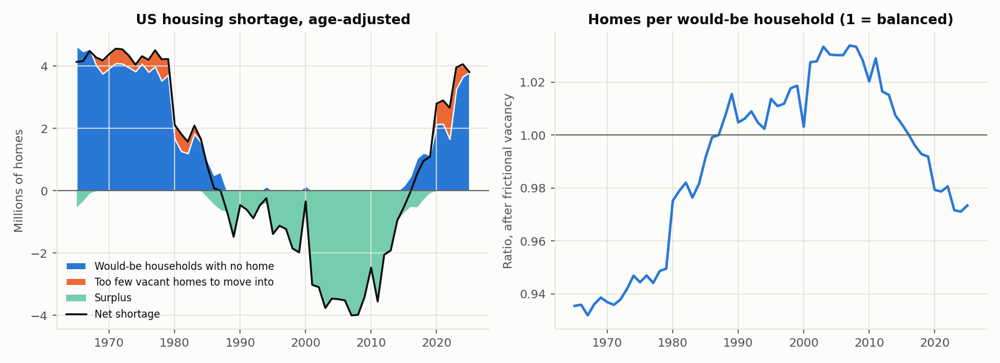

*The US went from a surplus of about 3.5M homes in the 2005 bubble to a shortage of about 3.8M today. Today's gap shows up as households that never formed (young adults at home, doubled-up families), not as low vacancy. Jumps near 1980 and 2001 are Census re-benchmarking breaks in the household series.*

| Year | Homes per would-be household | Net shortage (M homes) | Reading |
|---|---:|---:|---|
| 1970 | 0.937 | +4.4 | Baby boomers forming households; partly different household norms |
| 1990 | 1.005 | −0.5 | Balanced (base year) |
| 2005 | 1.030 | −3.5 | Bubble overbuilding |
| 2015 | 1.004 | −0.5 | Back to balance |
| 2025 | 0.973 | +3.8 | Short; range 0–4.9M across assumptions |

## 3. How shortages take income

We ran a matching market for every year from 1965 to 2025. Each year uses that year's ratio of homes to would-be households and that year's real incomes. We then compared it with a **balanced** market at the same incomes. The difference is the effect of the shortage and nothing else.

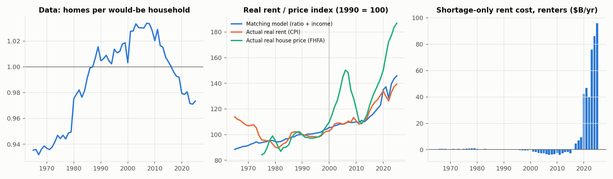

*In the model, the shortage alone raises 2025 rents by about 12.6%, roughly $96B a year from renters (about $276B if owners' implied rent is counted). It also leaves an extra 1.7% of would-be households without a home of their own. The metro data below give a smaller effect.*

### Testing it in the data: 241 metros, 2011–2025

For every metro we counted the homes its new residents needed (at 2.5 people per home, plus replacement of worn-out homes) and subtracted the homes actually permitted. The difference, added up since 2010, is that metro's shortage. We compared metros with each other, removing anything that moved all metros together, such as national incomes, interest rates and inflation.

- **Shortages go with faster price and rent growth.** Each 10 homes per 1,000 residents of shortage means about **+5.9% home prices** (95% CI 4.7–7.1%, 241 metros) and **+2.2% rents** (CI 1.1–3.4%, 151 metros).
- **Building more slows growth.** For metros with the same population growth, 10 more homes permitted per 1,000 residents over 2015–24 means **2.0% slower rent growth** and **3.7% slower price growth** to 2025.
- **The direction of the bias favours the finding.** Developers build where they expect rents to rise, which makes building look less effective than it is. So the true effect of building is, if anything, larger.
- **Robustness.** Metros whose boundaries were redrawn between Census files had to be dropped, because their population counts jump artificially. The results hold whether the cutoff for "redrawn" is a 1%, 2%, 3%, 5% or 10% population jump. They disappear only when the redrawn metros are kept in.

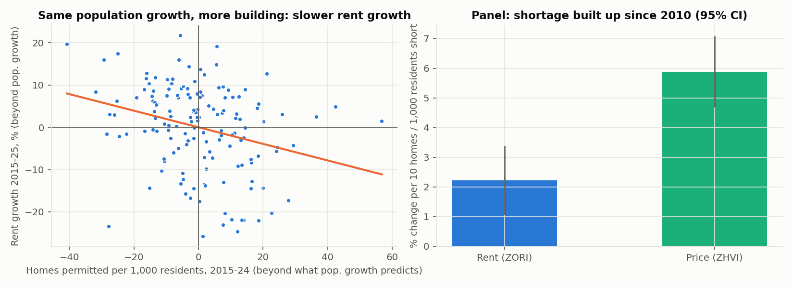

*Same population growth, more building: slower rent growth. Applied to a shortage of national size (about 11 homes per 1,000 residents), these estimates mean about +2.4% rents and +6.5% prices. That is about a fifth of the model's rent effect. Part of the gap is expected, because people can move away from a local shortage but not from a national one.*

Two more results:

- **A shortage becomes a price only when the people left out can afford to outbid.** The 1970s were more short than today, but at 1970s incomes most excluded households could not have paid construction cost anyway. Today they can, so they bid against each other, and owners collect the difference.
- **How much renters pay above income growth.** Comparing actual rents with rents that had grown in line with median income since 2000 gives an excess of about **$100B a year** (about $226B against inflation), or about **$1.5T** in total since 2000. This measures the total gap. It does not say how much of the gap the shortage caused.

*Home values have pulled away from both incomes and building costs. The typical home is about $70–93k above those paths, which adds up to $6–8T across owner-occupied homes. The carrying cost of that excess, about $0.4–0.5T a year, falls on recent buyers. The base year matters: measured from 2012, the excess rent paid by sitting tenants disappears. Since then the squeeze has landed on movers and new buyers.*

Why prices outran incomes: about 40% of the gap is rents rising faster than incomes. About 60% is a higher price-to-rent ratio, meaning low interest rates turned expected scarcity into higher asset prices. In the model, falling interest rates inflate prices *only* where supply is constrained. Where homes can be built freely, prices stay at building cost whatever rates do.

## 4. How shortages increase regret

Without money, scarcity shows up as worse matches. Our simulations reproduce two published results, and add one that matters for housing.

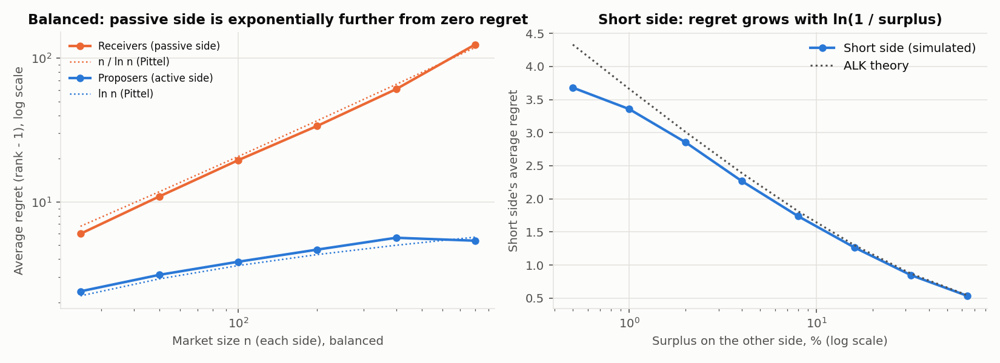

*Distance from zero regret. Left: in a balanced market the passive side's regret grows like n/ln n and the active side's like ln n. The passive side is exponentially further from zero regret (Pittel 1989). At 200 per side: 4.7 vs 33.8. Right: in unbalanced markets the short side's regret is about ln(1/surplus), whoever proposes (Ashlagi, Kanoria & Leshno 2017).*

1. **The side that is short wins, and the long side's regret explodes.** With one extra person on the long side, its average regret jumps from about 5 to about 35 (out of 200). Whether that side proposes or receives barely matters once the market is unbalanced.
2. **In housing the burden lands on the bottom (model result).** We model housing preferences as largely shared: most people want the same better homes, and owners prefer higher-income tenants. Under shared preferences the cliff disappears. A shortage then mainly decides *who is left with nothing*, and those are the lowest-ranked households. The shortage does not make everyone's home slightly worse. It shuts the bottom of the market out, through price and through exclusion.

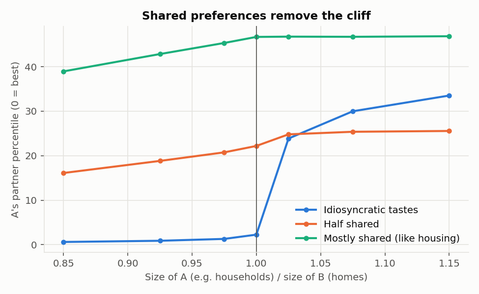

*When everyone agrees which homes are best, imbalance decides how many people at the bottom are left out rather than shifting everyone's match.*

## 5. Exploitation: when owners profit from emptiness

Scarcity creates a second incentive. A large owner can raise every other rent it collects by holding units empty. Under competitive prices in our model:

- a landlord with 10% of a market keeps **4 units empty** and rents rise **8.7%**;
- with 25% it keeps **14 empty** (+39%);
- with 50%, **22 empty** (+52%);
- with no concentration, none.

Withholding only pays when new supply cannot respond. If a withheld unit can be replaced by a new one, the strategy fails.

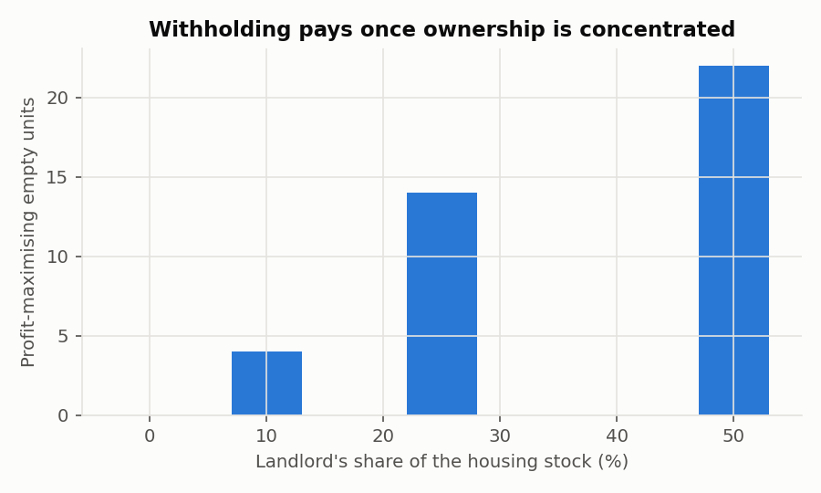

These are model results; we have not measured withholding in real ownership data.

The same matching mathematics applies outside housing, again as model results with illustrative parameters. In a model market with four meat processors, farm-gate prices settle about **20%** below value, exactly as monopsony theory predicts. In a model where patients can see only one price, a $5,000 procedure sells for about **$36,000** however many providers exist. Price transparency only helps there when there is spare capacity.

## 6. Fixed-rate mortgages: who carries the risk

Almost every US mortgage is a 30-year loan at a fixed rate that the borrower can refinance for free whenever rates fall. That design moves interest-rate risk off the household and onto whoever holds the loan. A large share of the holders are public institutions, or are backed by them.

- **The holder loses when rates rise.** In our model, a 2022-style rise (+4 points over 18 months) cut the value of the 2021 mortgage stock by about **13%**. Applied to who held it at the end of 2021, that is roughly **$344B** for the Federal Reserve, **$387B** for commercial banks and **$823B** for everyone else: **about $1.55T** in total (model estimate, market value). An adjustable-rate loan would have kept its value; the borrower would have carried the rise instead.
- **The public took a large share.** At the end of 2021 the Fed held **$2.6T** of mortgage-backed securities, about a fifth of all US mortgage debt. The Fed has since run a cumulative operating loss of **$231B**: the interest it pays on bank reserves exceeds what its long-term fixed-rate bonds earn. Until it earns that back, it sends nothing to the Treasury. Mortgage bonds are 28% of its assets; the rest is mostly long-term Treasuries with the same problem.
- **Rate hikes barely reached existing borrowers.** From the end of 2021 to now, the rate on a new mortgage rose **4.05 points**. The average rate actually paid on outstanding mortgages rose **0.77 points** (19% pass-through). That is about **$109B a year** in extra interest for households, against about **$567B** if loans were adjustable. Fixed rates blunt how hard Fed rate rises hit households' budgets.
- **Lock-in freezes the market.** Each point of gap between the new rate and the rate owners already pay cuts new for-sale listings by **6.7%** (2016–2026 data). The gap is now about 3 points, and 79% of loans are more than a point below market. In the matching model, locked-in owners stop selling *and* stop buying, so the market mostly thins rather than tips into shortage. Prices rise only slightly (+0.2–0.4 points), while the households left without a home rise from 13.2% to 14.2% and buyers' regret rises a little.

*The data. Left: Fed MBS buying and the mortgage spread. Middle: the lock-in gap between the new rate and the rate owners already pay (rebuilt from the full rate history). Right: Fed MBS holdings and its cumulative operating loss.*

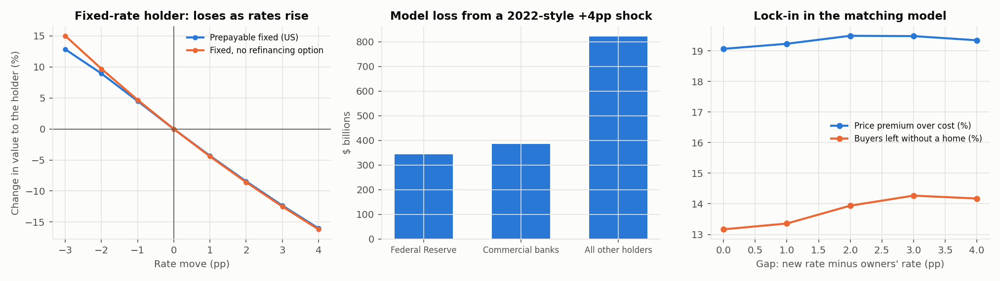

*The model. Left: a fixed-rate loan's value to its holder falls as rates rise. Middle: model losses by holder in a 2022-style shock. Right: lock-in in the matching model.*

Two parts of the common story did not hold up in our tests. **We found no clear subsidy through lower mortgage rates:** in months when the Fed was buying mortgage bonds, the gap between mortgage and Treasury rates was only 0.10 points lower, and not significantly so. Rate volatility explains the gap far better, which fits the gap mostly being the price of the refinancing option. **That option is priced, not free to the system:** in the model it costs borrowers 0.04–0.32 points a year in a higher rate, more when rates are high. We did not measure whether weaker pass-through made consumer inflation higher or longer-lasting; that needs a macroeconomic model or cross-country comparison.

## 7. Why mortgages? Four other ways to pay for housing

A mortgage lets a household bid for a home with income it has not earned yet. We ran the same matching market under five ways of paying for housing: cash only (an extreme benchmark), market-rate mortgages, subsidised fixed-rate mortgages (rate 1 point lower, as a scenario), government-built homes let at cost to the lowest-income 15%, and a Japan-like market where homes sell at construction cost and lose value with age. Each was run with today's shortage and with supply that responds to price.

### In the model

- **Credit inflates prices only when homes are short.** With today's shortage, what buyers pay existing owners for land each year goes from **1.2%** of income with cash only to **2.4%** with market mortgages and **2.9%** with subsidised fixed-rate loans. When supply responds to price, it is **zero** under every option: credit then lets more households buy (55% → 78%) without raising prices.
- **At-cost public housing reaches the households that mortgages miss.** It houses **78%** of the lowest-income fifth, against 3% with market mortgages and 12% with subsidised ones. It puts about **$33k** of public money at risk per household, against **$229k** of government-guaranteed loan balances in the subsidised mortgage system.
- **Depreciation happens either way; Japan's prices simply show it.** Buildings wear out like cars. In the Japan-like market an older home sells for less, so each buyer pays for the building they actually get, and no one pays a premium to existing owners for land. Section 8 shows how US prices hide the same wear.

*The model. Money paid to existing owners for land, the lowest-income fifth housed, and public money at risk, under each way of paying for housing. Blue: today's shortage. Green: supply responds to price.*

### In the data

- **The US and Japan went opposite ways.** Since 1995, inflation-adjusted house prices rose **88%** in the US and fell **23%** in Japan. Germany was flat; the UK rose 144%; Austria, despite its large social-housing sector, rose 26%.
- **The land premium is real money every year.** Each home sold today carries about **$71k** of value above what building costs justify. Across **4.0 million** sales a year, that is about **0.9% of GDP** paid to existing owners for land, about a third of the model's figure.
- **For a young family it is a large opportunity cost.** A first-time buyer pays that $71k premium through a 30-year mortgage: about **$5,500 a year**, **6.3%** of median household income. Kept and invested instead, those payments would be worth **$192k–$277k** after 30 years in today's dollars (3–5% real returns). Measured against income growth since 2000, the premium is $93k: **$7,200 a year** (8.2% of income), or **$251k–$362k** after 30 years.

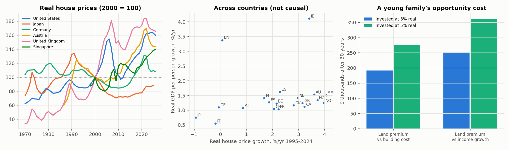

*The data. Inflation-adjusted house prices since 1970; house-price growth vs GDP growth across 20 countries (not causal); and what a young family's land premium would be worth if invested instead.*

**What this does not show.** It does not show that the US way of owning homes holds back national growth. Across 20 rich countries, faster house-price growth goes with *faster* GDP growth (+0.21, not significant), most likely because growth pushes house prices up. Japan, where homes depreciate, has also grown slowly, so it is no proof that depreciating homes deliver growth. What the evidence supports is narrower: in a shortage, mortgage credit and its subsidies are capitalised into land, and that land premium is paid by young families in money they cannot save, invest or spend on anything else.

## 8. Who pays: future families

A home's land value is the present value of the scarcity rents that future occupants will pay to live there. So when land values rise and the home provides no more housing than before, today's owner gains exactly what future buyers and renters will have to pay. Productive capital works differently: when a company becomes more valuable, the gain is backed by output it will create.

The part of house prices above what building costs justify is therefore not new wealth. It is a claim on the incomes of future families, and it creates nothing that will help them pay it. The part of the price that pays for construction and upkeep is real.

- **Today's claim on future families is $4.6–8.2T.** That is the land premium across owner-occupied homes since 2000: **$53k–93k per home**, which the next buyer of each home must pay. The low end values the building after wear (official BEA figures); the high end measures prices against income growth. People 55 and over hold **$2.9–5.1T** of it; people under 40 hold **$0.6–1.0T**.
- **Ownership has shifted to older households.** People 55 and over held **57%** of US home equity in 1990 and hold **73%** today; under-40s went from **10% to 7%**. Under-40s own $6.1T of real estate carrying $3.6T of mortgages; people 55 and over own $31.1T carrying $4.9T. Around 2010, under-40s' combined home equity was negative.
- **Each generation's gain is the next one's cost.** A household that bought a typical home at 30 in 1975 paid **3.2× income** and had gained **$129k** (in today's dollars, after inflation) when it sold at 60 in 2005. One that bought in 1995 paid **2.9×** and gained **$172k** by 2025. The 2025 buyer who paid that gain is paying **4.1× income**, and is already 3% down.
- **It only works while the next generation keeps paying.** The claim holds its value only if each new generation pays the premium again. If supply catches up, the premium shrinks, and the last households to buy take the loss. Japan's real house prices fell by about half after 1991.

*Who pays. Left: share of US home equity by age group (Federal Reserve Distributional Financial Accounts). Middle: typical home price relative to median income in the year a 30-year-old buys. Right: each buying generation's real gain by the time it sells at 60, or so far.*

Not all past gains are transfers: some reflect better homes and real costs, which is why the claim above counts only value beyond building costs. That the land premium is a transfer from future families follows from the arithmetic. Whether to call it theft is a judgment this paper leaves to the reader.

### Hidden wear: the used-car problem

Buildings wear out whether or not prices show it. Official figures (BEA) put the wear on US housing at **$799B a year**, about **2.4%** of the buildings' value, or roughly **$5,750 per home**. Since 2000 it adds up to **$15.2T** in today's dollars. Someone pays for that wear: the owner through upkeep and renovation, or the next buyer through the price.

- **US prices hide it.** In Japan an older home sells for less, like an older car. In the US, rising land values cover the wear, so a 30-year-old home can sell near the price of a new one. At 2.4% a year, a building keeps about **half** its value after 30 years unless the owner pays to renovate: about **$121k** of wear on today's typical building. A family that buys an unrenovated older home at full market price is paying for wear the seller used up, on top of the land premium.
- **But buildings themselves got more expensive.** BEA values each home's worn building at what it would cost to build today. That figure rose from **$152k to $248k per home** after inflation since 2000: about a third from construction materials costing more, and the rest from bigger new homes and renovations owners paid for. So when the building is valued after wear, the land premium is **$53k per home**, smaller than the $91k measured against a new building. Both numbers are reported. Part of that "more building per home" is renovation and flipping of the cheapest homes, which removes the cheap first rung rather than adding homes (next), so the $53k figure understates what first-time buyers lose.

*Where the price goes. Left: a typical US home's price split into the building after wear (BEA net stock per home) and land and scarcity. Right: the land premium per home since 2000, with the building valued as new and valued after wear. BEA's per-home building value averages over apartments too, which are smaller than a typical owner-occupied home, so the land share is somewhat overstated in level; the change since 2000 is more reliable.*

### The bottom rung: flipping and the cheapest homes

If worn homes fell in price the way cars do, they would be the cheap first step into ownership. Flipping turns them into renovated homes sold near new prices. The data show the bottom rung getting harder to reach fastest; the model shows how flipping does it.

- **The cheapest homes rose fastest.** Since the 2012 low, the cheapest third of US homes rose **86%** after inflation, against 68% for the middle third and **55%** for the priciest third. The cheapest homes went from **1.4× median income** in 2000 to **2.2×** today. The bottom outpaced the top in **all 100** of the largest metros (median gap 28 points). The data cannot say how much of this is flipping, investor buying or a shortage concentrated at the low end.
- **In the model, flipping pays only when renovated homes sell above cost.** When renovating costs as much as building new, flippers take **18%** of homes in a balanced market but **45%** in a short one, and the lowest-income fifth housed falls from 29% to **4%**. Once renovation is cheaper than the price premium it earns, flippers take almost every worn home: homes under $200k disappear and the lowest-income fifth is shut out entirely. A shortage is what makes the premium, and the premium is what makes flipping pay.
- **Renovation adds real value, but it removes a choice.** A flipped home is a better home. The cost is that families who would have taken a worn home at a low price no longer have that option.

*The bottom rung in the data. Left: US home prices by third, after inflation, 2012 = 100 (Zillow). Right: cheapest-third growth minus priciest-third growth since 2012, 100 largest metros.*

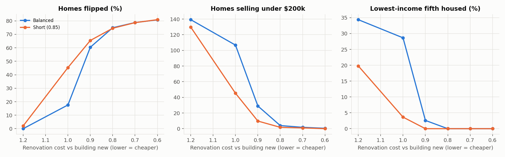

*Flipping in the model. As renovation gets cheaper relative to building new, flippers take more worn homes, homes under $200k vanish, and the lowest-income fifth loses access. Orange: a market short of homes; blue: balanced.*

### Landlords: the same squeeze, collected every year

A landlord values a home by the rent it will earn. In a shortage, renters bid rents up, so landlords can pay more for homes and outbid first-time buyers, especially those short of a down payment. It is the same mechanism as flipping, with a different exit: the home stays a rental, and the scarcity premium is collected as rent every year instead of once at resale.

- **In the model, the shortage hands entry homes to landlords.** With investors expecting a 5% return, their share of homes rises from **24%** in a balanced market to **28%** when homes are 10% short, and homeownership in the lower-income half falls from **54% to 34%**. With cheaper capital (a 4% return), investors' share goes from 30% to **40%** and lower-income ownership from 42% to **15%**. Rent above the landlord's costs rises with the shortage, from about $260 to $990 a year per rental at 5%, and to about $2,700 at 4%.
- **Down payments matter even without a shortage.** With homes plentiful, investors still buy 15–30% of homes in the model, because many households lack 10% down and investors outbid them. The shortage widens that gap.
- **The data show real estate shifting toward the wealthiest.** The top 1% by wealth held **9.4%** of US household real estate in 1989 and **13.4%** today; the bottom half went from **11.8% to 9.7%**. These figures include homes people live in, second homes and rentals together, so they fit the landlord story without proving it.

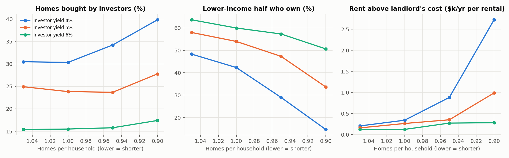

*Landlords in the model. As homes get shorter (left to right), investors buy more of them, the lower-income half loses ownership, and rent above landlords' costs rises; all three effects are stronger when investors' capital is cheaper.*

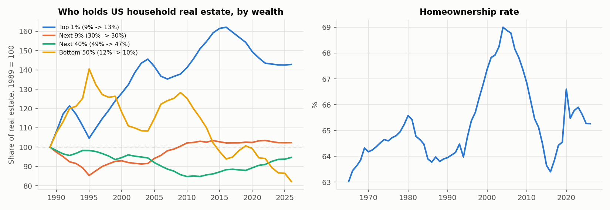

*Who holds the real estate. Left: each wealth group's share of US household real estate, relative to 1989 (Federal Reserve Distributional Financial Accounts). Right: the homeownership rate; the 2020 spike is a known pandemic survey artifact.*

## 9. What the evidence supports, and what it does not yet

A whitepaper that argues for change has to be clear about the strength of each claim. This is our own assessment:

| Claim | Status | Evidence |
|---|---|---|
| Land-price gains are claims on future families' income | **Supported** | Follows from how land is valued; today's claim is $4.6–8.2T ($53k–93k per home) |
| Home equity has shifted to older households | **Supported** | 55+ share 57% → 73% since 1990; under-40s 10% → 7% |
| Today's buyers pay far more of their income to get in | **Supported** | 4.1× income in 2025 vs 2.9× in 1985–1995; earlier buyers' gains were paid by later ones |
| Homes wear out by about $800B a year, and US prices hide it | **Supported** | BEA: 2.4% of building value a year, $15.2T since 2000; prices of older homes do not fall with it |
| Valuing buildings after wear makes the land premium larger | **Not shown** | It is smaller ($53k vs $91k per home): replacement costs rose 63% after inflation since 2000 |
| The cheapest homes have become dearer fastest | **Supported** | Bottom third +86% vs top third +55% after inflation since 2012; all 100 largest metros; 1.4× → 2.2× income |
| Flipping removes the bottom rung | **Model only** | Strong when renovation is cheap relative to the premium on renovated homes, and when homes are short; flipping itself not measured in data |
| Shortages and cheap capital let landlords outbid first-time buyers | **Model only** | Investor share 24% → 28% (30% → 40% with cheap capital) as homes go 10% short; lower-income ownership 54% → 34% |
| Real estate has shifted toward the wealthiest households | **Supported** | Top 1% share 9.4% → 13.4%, bottom half 11.8% → 9.7% since 1989; rentals not separated |
| The US is short about 4 million homes relative to would-be households | **Supported** | 3.8M central estimate; 0–4.9M across assumptions; consistent with published estimates |
| Metros with bigger shortages see faster rent and price growth | **Supported** | Metro panel: +2.2% rents, +5.9% prices per 10 homes per 1,000 residents short; robust to the boundary filter |
| Building more homes slows rent and price growth | **Supported** | Same population growth, 10 more homes per 1,000 residents: rents −2.0%, prices −3.7%. Bias runs against the finding |
| Size of the shortage's effect on rents | **Range** | About +2.4% (metro data, a within-country lower bound) to +12.6% (calibrated model) |
| Renters pay about $100B a year more than income growth would imply | **Supported** | Measured gap since 2000; size depends on base year; not all of it is caused by the shortage |
| Most of the money is a transfer, not destroyed output | **Supported** | Directly destroyed output is $2–8B a year. Wider growth losses (workers unable to move to productive cities) are argued in the literature but disputed, and we did not measure them |
| Shortage harms concentrate on the lowest-ranked households | **Model only** | Follows from shared-preference matching; not measured in household data |
| Fixed-rate mortgages move rate risk from borrowers to lenders, a large share of them public | **Supported** | Fed held $2.6T (about a fifth of mortgage debt); model loss about $1.55T across holders in a 2022-style shock; Fed operating loss $231B |
| Rate hikes reach existing borrowers only weakly | **Supported** | 19% pass-through since 2021: +$109B a year in interest vs +$567B if adjustable |
| Rate lock-in cuts homes offered for sale | **Supported** | −6.7% new listings per point of rate gap; gap now about 3 points |
| Lock-in raises prices | **Small, model only** | +0.2–0.4 points in the matching model; not estimated in data |
| Fed mortgage-bond buying lowered mortgage rates | **Not found** | −0.10 points, not significant, in our monthly spread test |
| With homes short, mortgage credit and subsidies flow into land prices | **Model** | Land payments 1.2% (cash) → 2.4% (mortgages) → 2.9% (subsidised) of income; zero when supply responds |
| At-cost public housing reaches the lowest incomes with less public money at risk | **Model** | 78% of the bottom fifth housed vs 3–12%; $33k vs $229k public exposure per household |
| Young families pay a large land premium | **Supported** | $5,500–7,200 a year (6–8% of median income); $192k–$362k if invested for 30 years |
| Homes that depreciate (Japan-like) lead to faster national growth | **Not shown** | Across countries, faster price growth goes with faster growth; Japan grew slowly |
| Low interest rates inflate prices mainly where supply is constrained | **Mixed** | Confirmed with a land-share proxy; not with the pre-specified index; not before 2020 |

> **What the evidence establishes.** The country is short of homes. Where the shortage is bigger, rents and prices rise faster. Where more is built, they rise more slowly. The extra money flows from renters and new buyers to existing owners. We do not test what caused the shortage. Prior research links land-use rules to high prices in constrained metros (Glaeser & Gyourko 2018), but our data cannot separate rules from other barriers.

## 10. What would fix it, and how to know if it is getting worse

In the model, the remedy is to make supply responsive again. Responsive supply removes the scarcity rent, the incentive to withhold, and the link between interest rates and asset prices, all at once. The metro data support the central step: more building, slower rent growth.

- **Let quantity respond to price.** Wherever homes sell far above the cost of building them, find and remove what stops new supply. Which barriers matter most in each metro is beyond what this paper tests.
- **Make withholding unprofitable.** The model says to watch vacancy where ownership is concentrated.
- **Watch for regression.** Our monitor flags metros where prices outran incomes while for-sale inventory fell. Syracuse, Hartford, Rochester, New Haven and Bridgeport lead today; Austin and San Antonio, where building boomed, do the opposite.

*Points in the lower right are metros where prices rose faster than incomes while the stock offered for sale shrank.*

Decisive next tests, in order:

1. An **instrumented version of the metro test**, using supply shifters that developers do not choose, such as geography or regulation changes. It would turn the association into a causal estimate.
2. A rate-sensitivity test using an exogenous supply measure (the Saiz or Wharton regulation indices) and monetary-policy surprises.
3. Natural experiments in reform (Auckland 2016, Minneapolis 2040) to measure what happens to quantity and rents when supply is freed.

**References.** Ashlagi, Kanoria & Leshno (2017) *JPE*. Demange, Gale & Sotomayor (1986) *JPE*. Gale & Shapley (1962) *AMM*. Glaeser & Gyourko (2018) *JEP*. Greaney (2020) working paper. Hsieh & Moretti (2019) *AEJ: Macro*. Leonard (1983) *JPE*. Pittel (1989) *SIAM J. Discrete Math.* Saiz (2010) *QJE*. Shapley & Shubik (1971) *IJGT*.

*Simulations are stylised and their parameters illustrative; empirical estimates rest on the assumptions stated in each section.*

---

# Code and reproduction

This project models housing, food/agriculture and healthcare as **two-sided
matching markets**. It measures scarcity rent, market power and lost trade,
and estimates how much US housing scarcity transfers from non-owners each
year.

* **Technical framework:** [paper/framework.md](paper/framework.md). It has the
  model, measures, proofs, results, the experiments that detect regression, and
  the limitations.
* **Reproduce:** `python run_all.py` (about 15 minutes; downloads about 9 MB of
  public Zillow, FRED and Census CSVs into `data/raw/`).

| Path | What it does |
|---|---|
| `mel/assignment.py` | Assignment game solver plus exact core bounds (buyer-optimal/VCG and owner-optimal prices) |
| `mel/gale_shapley.py` | Deferred acceptance (matching without money) |
| `mel/metrics.py` | Scarcity rent, owner share, core position, Lerner, DWL, elasticity, HHI |
| `sims/s01_dating.py` | Toy dating market: short-side power, with and without money |
| `sims/s02_housing.py` | Housing supply regimes, capitalisation under falling rates, landlord withholding |
| `sims/s03_food.py` | Farmers matched to few processors (monopsony); checked against theory |
| `sims/s04_healthcare.py` | Patients ↔ providers with insurance, capacity caps, price opacity |
| `data_pipeline/fetch_data.py` | Downloads Zillow ZHVI/ZORI/inventory, FRED series and Census permit/population files |
| `data_pipeline/housing_extraction.py` | US excess rent / excess home value vs income-, inflation- and cost-anchored counterfactuals |
| `data_pipeline/monitor.py` | Metro "market regression" screen (prices vs incomes vs quantity) |
| `data_pipeline/e2_rate_gradient.py` | Experiment E2: do constrained metros react more to interest rates? (local projections, two-way clustered) |
| `sims/s05_e2_method_check.py` | Runs the E2 estimator on synthetic data where the answer is known (true effect / placebo / confound) |
| `sims/s06_imbalance_shape.py` | How each side fares as a Gale-Shapley market becomes unbalanced (random vs shared preferences, regret scaling) |
| `data_pipeline/shortage.py` | US homes vs would-be households, 1965-today: age-adjusted shortage accounts |
| `sims/s07_housing_history.py` | A matching market for every year calibrated to that ratio; the shortage's own effect on rents; tests against actual rents/prices |
| `data_pipeline/fixed_rate_data.py` | Fixed-rate mortgages in the data: spread vs Fed MBS buying, rebuilt outstanding rate and lock-in, who held the risk, rate pass-through |
| `sims/s08_fixed_rate.py` | Fixed-rate mortgage model: price of the refinancing option, losses by holder in a rate shock, lock-in in the matching market |
| `sims/s09_financing_regimes.py` | Five ways to pay for housing (cash, mortgages, subsidised fixed, public at cost, depreciating) in the matching market |
| `data_pipeline/housing_growth_data.py` | US vs Japan and other countries' house prices, land premium in the data, young families' opportunity cost, cross-country growth check |
| `data_pipeline/generations.py` | Who pays: home equity by age (Fed DFA), today's land premium as a claim on future families, each buying generation's price and gain since 1975 |
| `data_pipeline/depreciation.py` | Hidden wear: BEA depreciation of housing, a typical home's price split into worn building vs land, land premium against a worn building |
| `data_pipeline/bottom_rung.py` | Cheapest vs priciest thirds of homes (Zillow tiers): US and 100 largest metros |
| `sims/s10_flipping.py` | Flippers in the matching market: when flipping pays and what it does to the cheapest homes |
| `sims/s11_landlords.py` | Landlords vs first-time buyers in the matching market, across shortage levels and investor cost of capital |
| `data_pipeline/ownership_concentration.py` | Household real estate by wealth group (Fed DFA) and the homeownership rate |
| `data_pipeline/metro_shortage.py` | Metro panel: homes permitted vs homes new residents needed, against Zillow rents and prices (fixed effects, robustness to boundary changes) |
| `whitepaper/` | Styled HTML version of the paper above, with its figures |
| `outputs/` | Figures (PNG) and tables (CSV) |

Requires Python 3.10+ with numpy, scipy, pandas, matplotlib and requests.
