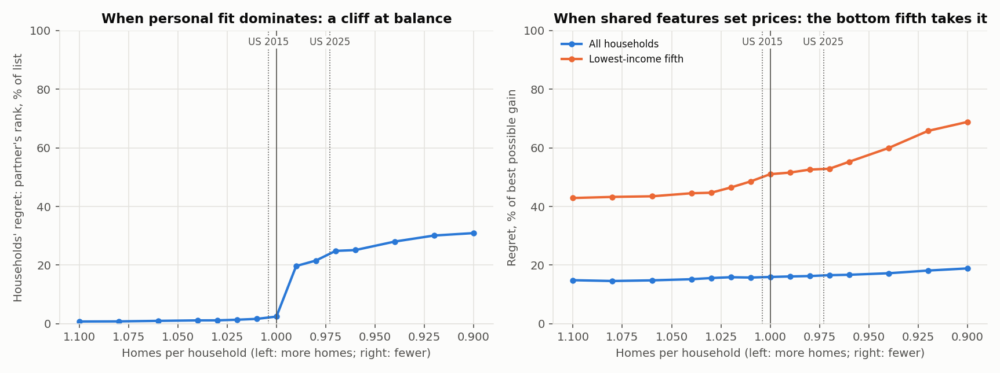
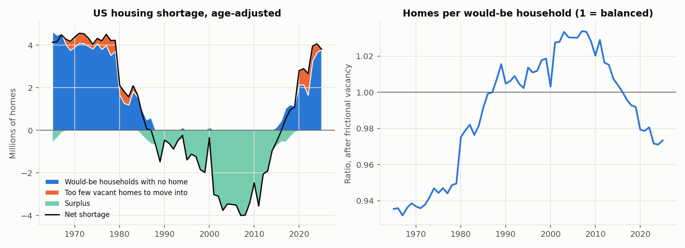
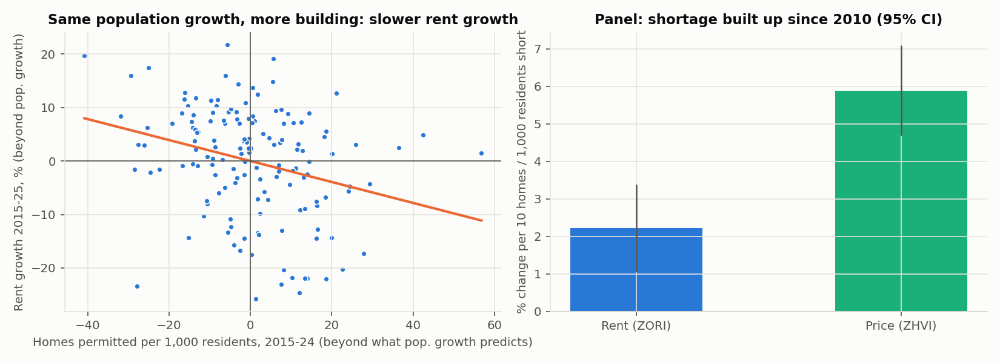
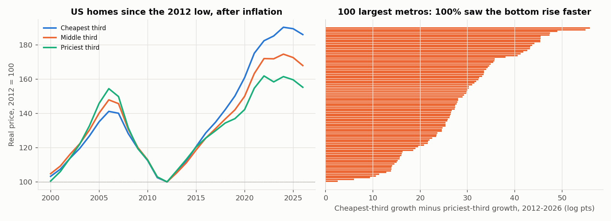
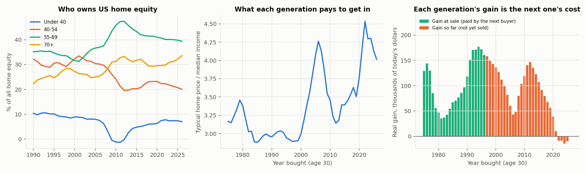

::: kicker
Working paper · Matching Elasticity Lab · November 2026
:::

# Small Shortages, Large Regret

::: dek
Housing is a matching market, and matching markets have a cliff. When homes and households are close to balance, a shortage of just a few percent multiplies how far people land from the home they would have chosen. The United States has just gone over that edge: about four million homes short, 2.7% fewer homes than would-be households. The lowest-income households fall first.
:::

::: meta
Data: Zillow Research, FRED, US Census, Bureau of Economic Analysis and Federal Reserve, 1965 to October 2026. Every number comes from open code (`python run_all.py`). Proofs and technical detail: [paper/framework.md](https://github.com/wesboyt/elastic-matching/blob/main/paper/framework.md).
:::

::: ledger
~20× | more regret 3% short than 3% in surplus, when personal fit matters (matching model)
3.8M | homes short in 2025: 2.7% fewer homes than would-be households
+5.9% | home prices (and +2.2% rents) per 10 homes per 1,000 residents short, 241 metros | loss
+86% | rise in the cheapest homes since 2012 after inflation, vs +55% for the priciest | loss
$5–8T | of home value that is a claim on future families' income | loss
:::

## The argument in brief

1. **Matching markets have a cliff at balance.** Whoever is on the short side captures the gains. Crossing from a small surplus of homes to a small shortage multiplies regret, the distance between the home people get and the one they would choose.
2. **The US has just crossed it.** The country went from a surplus of homes in 2005 to rough balance in 2015 to 2.7% short today.
3. **In housing, the cliff lands on the bottom.** Prices are set mostly by features everyone values the same way: rooms, square footage, location. So a shortage does not spread regret evenly. It concentrates it on the lowest-income households, and the data show the cheapest homes rising fastest in every large metro.
4. **Small shortages have measurable costs.** Metros that built fewer homes per new resident saw faster price and rent growth.
5. **The bill goes to future families.** Today's owners hold a claim on what the next generation will pay.
6. **The cliff works both ways.** A few percent more homes would move the market back off the edge.

## 1. The regret cliff

Each household occupies one home and each home houses one household: a two-sided matching problem, the same mathematics used to match medical residents to hospitals (Gale & Shapley 1962). We measure **regret** as distance from zero regret: how far down your own list your match is, or in money, how much of your best possible gain you do not get.

**When personal fit dominates, regret has a cliff at balance.** Picture households that care mainly about fit: a home near *their* job, near *their* family. In a market of 200 homes:

- With 3% more homes than households, households land on average **1%** of the way down their list. At exact balance, about **2%**. With just **1%** too few homes, about **20%**. At 3% too few, **25%**.
- That is about **20 times** more regret at 3% short than at 3% in surplus. Beyond that, extra shortage adds regret slowly; the damage is done at the edge.
- It does not matter who makes the offers. What matters is which side is short (Ashlagi, Kanoria & Leshno 2017).
- At exact balance, the side that waits for offers is exponentially further from zero regret than the side that makes them: in a 200-person market, regret of 33.8 places versus 4.7 (Pittel 1989).

**In housing, shared features set most of the price, and the cliff lands on the bottom.** Rooms, square footage and location quality are valued the same way by nearly everyone, so households compete for the same homes in order of what they can pay. A shortage then does not push everyone down their list. It decides who is left with the worst options or none:

- Across all households, regret barely moves: from **16%** of the best possible gain with 3% more homes to **17%** at today's 2.7% shortage.
- For the lowest-income fifth it climbs: **45%** to **53%**, and **69%** at 10% short. The share of them with a home of their own falls from 35% to 26%.
- These use the most tenant-friendly competitive prices, so they are a lower bound. At mid-range prices the lowest-income fifth goes from 62% to 69% to 81%.

: **Small shortages, large regret.** Left: when personal fit dominates, regret jumps as homes fall just below households. Right: when shared features set prices, average regret barely moves while the lowest-income fifth's regret climbs. Dotted lines: where the US stood in 2015 and stands today.

## 2. The US has just gone over the edge

We compare **homes on the market** (occupied, plus vacant for rent or for sale) with **would-be households**: the households that would exist if adults formed them at 1990 rates, adjusted for an older population. We allow 3.3% vacancy so people can move.

- About **3.5M homes in surplus** at the 2005 peak of overbuilding; rough balance by 2015; about **3.8M short** today (0.973 homes per would-be household; range 0–4.9M across assumptions).
- Today's gap shows up as households that never formed (young adults at home, doubled-up families), not as low vacancy. Households per adult have stayed at about 0.49 since 1990 even though the population aged, which on its own should have raised it.

: **From surplus to shortage.** Left: homes short (positive) or in surplus (negative), in millions. Right: homes per would-be household; 1 is balance. Jumps near 1980 and 2001 are Census re-benchmarking breaks.

## 3. Small shortages, measurable costs

For 241 metros we counted the homes each metro's new residents needed and subtracted the homes actually permitted, then compared metros with each other, removing anything that moved all metros together (national incomes, interest rates, inflation).

- Each 10 homes per 1,000 residents of shortage goes with **+5.9% home prices** (95% CI 4.7–7.1%) and **+2.2% rents** (CI 1.1–3.4%, 151 metros). At the national shortage, that is about **+6.5% prices and +2.4% rents**.
- For metros with the same population growth, 10 more homes permitted per 1,000 residents means **2.0% slower rent growth** and **3.7% slower price growth**.
- Developers build where they expect rents to rise, which makes building look less effective than it is, so the true effect is if anything larger. Results hold under every sample cutoff we tried.

: **Same population growth, more building: slower rent growth.** Left: each dot is a metro, after removing what population growth predicts. Right: the effect of a shortage on prices and rents, with 95% intervals.

Renters now pay about **$100 billion a year** more than if rents had tracked median incomes since 2000, and typical home prices went from **3.0 to 4.0 times** median income. The shortage is one cause of that gap among others.

## 4. The bottom rung goes first

This is the cliff's prediction for housing, and the data match it. **Since the 2012 low, the cheapest third of US homes rose 86%** after inflation, against 68% for the middle third and **55%** for the priciest third. The bottom outpaced the top in **all 100** of the largest metros, by a median of 28 points. The cheapest homes went from **1.4× to 2.2×** median income.

Older, smaller homes would otherwise be the cheap first step into ownership. Flipping and investor purchases are plausible channels for their disappearance; the data here cannot separate them from other causes.

: **The bottom rung in the data.** Left: US home prices by third, after inflation, 2012 = 100. Right: cheapest-third growth minus priciest-third growth since 2012, 100 largest metros.

## 5. Who pays: future families

A home's land value is the present value of the rents future occupants will pay to live there. When land values rise and the home provides no more housing than before, today's owner gains exactly what future buyers and renters will pay, and nothing new is produced to pay it with.

- **Today's claim is $4.6–8.2 trillion**: $53k–93k per home, which the next buyer must pay. People 55 and over hold **$2.9–5.1T** of it; people under 40 hold **$0.6–1.0T**.
- **Ownership has shifted to older households.** People 55 and over held **57%** of US home equity in 1990 and hold **73%** today; under-40s went from 10% to 7%.
- **Each generation's gain is the next one's cost.** Buying at 30 in 1995 cost 2.9× income and left a **$172k** gain (today's dollars) at sale in 2025. The 2025 buyer paying that gain is paying **4.1× income**. For a young family the land premium costs about **$5,500 a year**, 6.3% of median income, for 30 years.
- **Buildings wear out, but US prices hide it.** Official figures put the wear on US housing at **$799B a year**, about $5,750 per home. In Japan an older home sells for less, like an older car; in the US, rising land values cover the wear, so buyers pay near-full price for partly used-up buildings.

: **Who pays.** Left: share of US home equity by age (Federal Reserve). Middle: typical home price relative to median income when a 30-year-old buys. Right: each buying generation's real gain at sale, or so far.

## 6. How the market's plumbing amplifies it

Two features of US housing finance push in the same direction, both measured in the data:

- **Fixed-rate mortgages move interest-rate risk to lenders, a large share of them public.** At the end of 2021 the Federal Reserve held **$2.6T** of mortgage bonds, about a fifth of US mortgage debt; it has since run a **$231B** operating loss, during which it sends nothing to the Treasury. When rates rose 4.05 points, the average rate actually paid rose 0.77 (19% pass-through).
- **Lock-in thins the market further.** Each point of gap between new and existing mortgage rates cuts new listings by **6.7%** (se 0.7); the gap is now about 3 points. Fewer homes offered means a thinner market, which is the side of the cliff where regret rises.

## 7. The cliff works both ways

The same arithmetic that makes small shortages costly makes small amounts of building powerful.

- **In the matching model**, moving from today's 2.7% shortage to 3% in surplus cuts regret where personal fit matters from **25%** to about **1%**, and cuts the lowest-income fifth's regret from **53%** to **45%** where shared features set prices.
- **In the metro data**, 10 more homes per 1,000 residents means about 2% slower rent growth and 4% slower price growth.
- **A few percent is about four million homes.** Wherever homes sell far above what they cost to build, the task is to find and remove what stops new supply. Which barriers matter most in each metro is beyond what this paper tests.

## 8. What the evidence supports, and what it does not

| Claim | Status | Evidence |
|---|---|---|
| Matching markets have a regret cliff at balance | Supported | Established theory (Ashlagi, Kanoria & Leshno 2017; Pittel 1989); reproduced in simulation |
| In housing, the cliff lands mostly on the lowest-income households | Model only | Regret for the lowest-income fifth 45% → 53% → 69%; average 16% → 17% |
| The US is short about 4 million homes (2.7%) | Supported | 3.8M central estimate; 0–4.9M across assumptions |
| Metros with bigger shortages see faster rent and price growth | Supported | +2.2% rents, +5.9% prices per 10 homes per 1,000 residents short |
| Building more homes slows rent and price growth | Supported | Same population growth, 10 more homes per 1,000: rents −2.0%, prices −3.7% |
| The cheapest homes have become dearer fastest | Supported | Bottom third +86% vs top +55% since 2012, in all 100 largest metros |
| Land-price gains are claims on future families' income | Supported | Follows from how land is valued; $4.6–8.2T today |
| Home equity has shifted to older households | Supported | 55+ share 57% → 73% since 1990 |
| Homes wear out by about $800B a year and US prices hide it | Supported | BEA: 2.4% of building value a year |
| Fixed-rate mortgages move rate risk to lenders, many of them public | Supported | Fed held $2.6T; Fed operating loss $231B; 19% pass-through |
| Rate lock-in cuts homes offered for sale | Supported | −6.7% new listings per point of rate gap |
| The average household faces a regret cliff in housing | Not shown | Where shared features set prices, average regret rises only slightly |

> **What the evidence establishes.** Matching markets turn small shortages into large regret, and the US has just crossed from surplus into shortage. In housing, where shared features set prices, the regret falls hardest on the lowest-income households, and the cheapest homes are disappearing fastest. Where the shortage is bigger, prices and rents rise faster; where more is built, they rise more slowly. We do not test what caused the shortage; prior research links land-use rules to high prices in constrained metros (Glaeser & Gyourko 2018).

## 9. Method and reproducibility

All results come from open Python code: an exact solver for matching with prices, Gale–Shapley matching without prices, and metro panels with fixed effects. `python run_all.py` downloads the public data and regenerates every number and figure.

::: refs
Ashlagi, Kanoria & Leshno (2017) *JPE*. Demange, Gale & Sotomayor (1986) *JPE*. Gale & Shapley (1962) *AMM*. Glaeser & Gyourko (2018) *JEP*. Pittel (1989) *SIAM J. Discrete Math.* Saiz (2010) *QJE*. Shapley & Shubik (1971) *IJGT*.
:::
